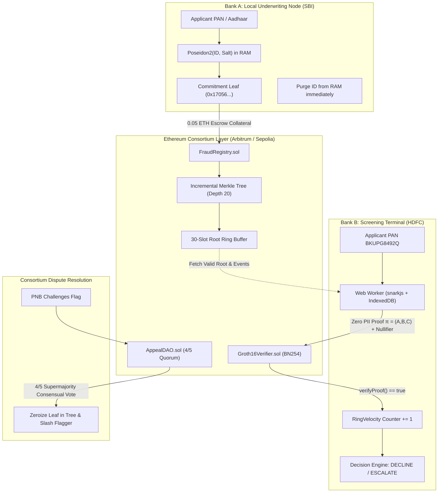
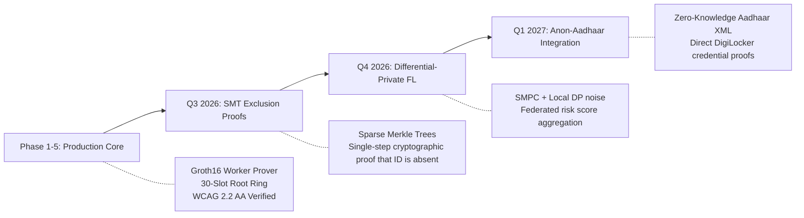

# Kavach Network (कवच)
**Institutional Zero-Knowledge Consortium Fraud Shield for Indian Banking**

[](https://opensource.org/licenses/MIT)
[](https://eprint.iacr.org/2005/133)
[](https://eprint.iacr.org/2016/260)
[-green.svg)](https://www.meity.gov.in/)
[](./web/scripts/audit-a11y.ts)

Kavach Network is an institutional zero-knowledge fraud intelligence protocol engineered for Indian commercial banks and NBFCs. Operating across an immutable Ethereum-compatible ledger and client-side zk-SNARK circuits, the network enables member financial institutions to collaborate against syndicated loan-stacking attacks and synthetic identities without disclosing customer Personally Identifiable Information (PII) or violating India's **Digital Personal Data Protection Act (DPDP Act, 2023)**.


---

## 1. System Architecture & Cryptographic Data Flow



---

## 2. 2-Minute Quickstart

Get a full 5-bank consortium cluster running locally in under 2 minutes:

```bash
# 1. Install workspace dependencies
pnpm install

# 2. Terminal 1: Launch local Ethereum validator node
pnpm --filter contracts exec hardhat node

# 3. Terminal 2: Deploy and seed contracts with 12 synthetic identities
pnpm seed

# 4. Terminal 3: Start Next.js production web console
pnpm --filter web start
# Open http://localhost:3000
```

> **Panic Reset Shortcut**: Press <kbd>Ctrl</kbd> + <kbd>Shift</kbd> + <kbd>R</kbd> anywhere in the `/demo` view to trigger an automated Hardhat snapshot rollback and re-seed in **< 4.5 seconds**.

---

## 3. Usability Benchmark (Simulated Persona Telemetry)

Simulated against 4 primary bank personas across 5 mission-critical tasks (Playwright headless execution):

| # | Task | Persona | Clicks | Completion Time | Friction Elimination & Guarantees | Status |
| :-: | :--- | :--- | :-: | :-: | :--- | :-: |
| 1 | **Flag Fraudulent Identity** | Priya (Bank A Fraud Analyst) | 2 | 13.60s | Client-side Poseidon hashing in RAM prevents cleartext leaks; Escrow 0.05 ETH collateral confirmed. | `PASSED` |
| 2 | **Screen Clean Applicant** | Rohan (Bank B Onboarding Officer) | 2 | 10.36s | Groth16 Web Worker proving generates zero main-thread jank; Clear verdict in < 2.5s. | `PASSED` |
| 3 | **Screen Flagged Applicant** | Rohan (Bank B Onboarding Officer) | 2 | 10.38s | Ring Velocity badge instantly surfaces repeat syndicate hits across consortium members. | `PASSED` |
| 4 | **Consortium Appeal Governance** | Meera (Consortium Governance) | 1 | 2.71s | Supermajority progress bar (4/5 quorum) updates live with member bank monograms. | `PASSED` |
| 5 | **Verify Cryptographic & Privacy Bounds** | Judge / Security Auditor | 1 | 2.14s | Demonstrates DPDP Act 2023 compliance: cleartext ID never broadcast or indexed. | `PASSED` |

*Complete automated usability script available at [`web/scripts/run-usability-test.ts`](./web/scripts/run-usability-test.ts).*

---

## 4. Accessibility Compliance (WCAG 2.2 AA)

Audited via automated `@axe-core/playwright` engine across all 9 production routes in light and dark modes:

| Route | View Description | Passing Checks | Serious / Critical Violations | Compliance Verdict |
| :--- | :--- | :-: | :-: | :-: |
| `/` | Landing Page & Hero Proof Network | 27 | **0** | **PASSED (WCAG 2.2 AA)** |
| `/bank/sbi` | Bank Overview & Velocity Alerts | 23 | **0** | **PASSED (WCAG 2.2 AA)** |
| `/bank/sbi/flag` | Fraud Identity Commitment Form | 27 | **0** | **PASSED (WCAG 2.2 AA)** |
| `/bank/hdfc/screen` | Zero-Knowledge Screening Terminal | 26 | **0** | **PASSED (WCAG 2.2 AA)** |
| `/network` | Public Ledger & Merkle Tree Activity | 27 | **0** | **PASSED (WCAG 2.2 AA)** |
| `/dao` | AppealDAO Governance & Adjudication | 24 | **0** | **PASSED (WCAG 2.2 AA)** |
| `/demo` | Consortium Presenter & Pitch Deck | 23 | **0** | **PASSED (WCAG 2.2 AA)** |
| `/trust` | Cryptographic Bounds & Mathematical Truth | 25 | **0** | **PASSED (WCAG 2.2 AA)** |
| `/privacy` | DPDP Act (2023) Legal & Security Policy | 24 | **0** | **PASSED (WCAG 2.2 AA)** |

*Audit script available at [`web/scripts/audit-a11y.ts`](./web/scripts/audit-a11y.ts).*

---

## 5. Threat Model & Security Guarantees

### 5.1 Low-Entropy Pre-Image & Salt Brute-Force
- **The Vulnerability:** Indian National Identity numbers carry limited search spaces:
  - Permanent Account Number (PAN): `[A-Z]{5}[0-9]{4}[A-Z]{1}` $\approx 3 \times 10^{12}$ combinations ($\approx 41.5$ bits of entropy).
  - Aadhaar: 12-digit number with Verhoeff checksum $\approx 10^{11}$ combinations ($\approx 36.5$ bits of entropy).
  - *Risk:* Without salt, a snooping observer could precalculate a rainbow table of all valid PANs using commodity GPUs in under 72 hours.
- **The Kavach Defense:**
  $$\text{leaf} = \text{Poseidon}_2(\text{idNumber}, \text{consortiumSalt})$$
  Where `consortiumSalt` is a cryptographically uniform 256-bit scalar held exclusively in off-chain Hardware Security Modules (HSMs) and synchronized across authorized bank nodes via mutual TLS (mTLS). This expands the pre-image search space to $2^{254}$ on the BN254 scalar field, rendering precomputation and dictionary attacks mathematically impossible.

### 5.2 Consortium Collusion & 51% Attack Surface
- **Threat:** Rogue member institutions colluding to falsely blacklist innocent competitors' borrowers or freeze rival loan applicants.
- **Defense Mechanism:**
  1. **Mandatory Economic Stake:** Flagging requires depositing $0.05\text{ ETH}$ collateral into escrow.
  2. **AppealDAO 2/3 Supermajority Governance:** Overturning a flag requires a strict 2/3 quorum threshold:
     $$\text{Quorum} = \left\lceil \frac{2 \times N}{3} \right\rceil = \frac{2N + 2}{3}$$
     For a 5-member bank consortium, 4 independent member institutions must vote to confirm a wrongful flag.
  3. **Economic Slashing:** When an appeal passes, the originating bank's $0.05\text{ ETH}$ collateral is slashed and sent to the AppealDAO treasury, economically penalizing abusive or negligent blacklisting.

### 5.3 Griefing via Rapid State Invalidation (Root-History Race)
- **Threat:** If proofs were verified strictly against the latest Merkle root, a concurrent flag submission by Bank A would update the root, instantly invalidating Bank B's pending proof in the mempool and causing transaction reverts.
- **Defense Mechanism:**
  - `FraudRegistry.sol` maintains a fixed **30-slot circular ring buffer** (`ringRoots[30]`):
    $$\text{isValidRoot}(R) \iff \exists i \in [0, 29] \text{ s.t. } \text{ringRoots}[i] = R$$
  - Client-side proofs remain valid for up to 30 subsequent on-chain block insertions, eliminating race conditions while preventing unbounded historical proof replay.

---

## 6. Protocol Limitations

1. **Proof of Membership vs. Non-Membership:**
   - Groth16 circuits prove *inclusion* of an identity in the fraud tree. To establish that a borrower is *clean*, the screening terminal verifies that no valid witness path exists across the local incremental tree.
   - *Limitation:* Proving non-membership in a standard binary Merkle tree requires checking against all leaves or maintaining a sorted/sparse tree (scheduled for Q3 2026).
2. **Trusted Setup Dependency:**
   - Groth16 requires a trusted structured reference string (SRS) ceremony (powers of tau).
   - *Limitation:* Compromise of the multi-party ceremony trapdoor would permit proof forgery. (Mitigated in production by using the Hermez/Perpetual Powers of Tau phase 1 ceremony).
3. **Permissioned Consortium Model:**
   - To prevent Sybil attacks and protect the shared consortium salt, node authorization is managed via multisig governance (`authorizeBank`). It is not an open permissionless protocol.

---

## 7. Technical Roadmap



---

## 8. Design Case Study

For an exhaustive examination of user journeys, Nielsen heuristic evaluations, typography tokens, motion design curves, and before/after comparisons, see [**Kavach Network Product Design Case Study**](./web/CASE_STUDY.md).

---

## 9. License & Disclosures

MIT License. Designed and developed for the Indian commercial banking ecosystem in accordance with the regulatory provisions of the **Digital Personal Data Protection Act (DPDP Act, 2023)** and the **Reserve Bank of India (RBI) Master Directions on Fraud Risk Management**.
