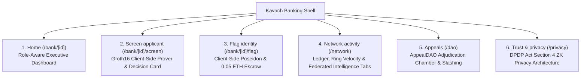

# Kavach Network — Institutional UX Specification & Design Standards

**Product:** Kavach Network (Zero-Knowledge Consortium Fraud-Intelligence)  
**Document:** `/web/UX_SPEC.md`  
**Target Roles:** Institutional Fraud Investigators, Credit Onboarding Underwriters, Consortium Governance Officers, Regulatory Evaluators.

---

## 1. User Personas & Core Journeys

### Persona 1: Priya — Senior Fraud Analyst, Bank A (State Bank of India)
* **Demographics & Context:** Handles post-disbursement forensic investigation, synthetic identity syndicates, and charge-off blacklists. Manages collateral staking and monitors cross-bank syndication attempts.
* **Core Goal:** Flag a confirmed fraudulent national identifier (PAN / Aadhaar) in **under 30 seconds** without transmitting cleartext customer records outside bank infrastructure, and immediately track whether the identity attempts concurrent onboarding at peer lenders.
* **Key Tasks:**
  1. Accesses `/bank/[id]/flag`.
  2. Inputs applicant ID; verifies client-side Poseidon BN254 commitment hash preview in browser memory.
  3. Selects fraud typology (e.g. "Synthetic Identity", "Loan Stacking") and escrow TTL.
  4. Confirms 0.05 ETH collateral deposit and submits on-chain commitment leaf.
  5. Receives instant cross-bank alert whenever peer consortium banks evaluate the same identity nullifier.
* **Target Metric:** Time-to-flag < 30 seconds; 0 bytes cleartext PII transmitted.

---

### Persona 2: Rohan — Credit Onboarding Officer, Bank B (HDFC Bank)
* **Demographics & Context:** Reviews retail personal loan applications under strict service-level agreements (SLAs). Operates under high throughput and cannot decipher raw cryptographic Merkle roots or zk-SNARK constraints.
* **Core Goal:** Screen an incoming loan applicant in **under 20 seconds** and receive an unambiguous institutional underwriting recommendation (**Clear**, **Review**, or **Decline**) with plain-language risk factors.
* **Key Tasks:**
  1. Opens `/bank/[id]/screen` (or invokes `Cmd+K -> Screen applicant`).
  2. Enters applicant national identifier; clicks "Run screening".
  3. Watches real-time client-side Groth16 witness generation.
  4. Obtains structured **Decision Card**:
     - **Decline Recommended:** Multi-bank syndication hit (Ring Velocity >= 2) or active fraud commitment within validity window.
     - **Manual Review Recommended:** In-flight appeal pending or expired commitment requiring secondary audit.
     - **Clear / Approve Recommended:** Non-membership verified against active consortium depth-20 Merkle tree.
  5. Confirms underwriting decision with institutional audit trail.
* **Target Metric:** Time-to-decision < 20 seconds; plain-language guidance with zero jargon confusion.

---

### Persona 3: Meera — Consortium Governance Member (Punjab National Bank)
* **Demographics & Context:** Appointed to the AppealDAO Adjudication Chamber. Reviews contested flags, assesses IPFS evidence dossiers submitted by affected borrowers, and enforces 2/3 supermajority consensus.
* **Core Goal:** Review and vote on a contested identity appeal in a **single consolidated screen** in under 45 seconds, with full defense documentation, flagger collateral stakes, and quorum countdown visible.
* **Key Tasks:**
  1. Navigates to `/dao` (or clicks alert in "Needs your attention" strip).
  2. Reviews disputed identifier (`BKUP••••9Q`), reporting bank (`Axis Bank`), and defense evidence CID (`ipfs://...`).
  3. Evaluates 2/3 supermajority voting progress (e.g. 3 of 4 votes reached).
  4. Casts on-chain vote (`Vote Uphold & Revoke` or `Vote Against Revocation`).
  5. Executes revocation once quorum is met, zeroizing the leaf in the Merkle tree and slashing flagger collateral.
* **Target Metric:** Single-screen dispute review; zero multi-tab hopping.

---

### Persona 4: Evaluator / Regulatory Judge (RBI / FinTech Sandbox Auditor)
* **Demographics & Context:** Evaluates the platform for DPDP Act (2023) Section 4 compliance, consortium decentralization, and cryptographic validity.
* **Core Goal:** Understand what the platform does, how the zero-knowledge privacy boundary works, and verify real cryptographic execution within **60 seconds of landing**.
* **Key Tasks:**
  1. Lands on `/`; reviews institutional headline, live consortium stats, and 12-bank member roster.
  2. Clicks "Open bank console" or navigates to "Trust & privacy".
  3. Inspects side-by-side data isolation matrix ("What Bank Sees / What Chain Sees / What Peer Banks See").
  4. Launches Presenter Pitch Mode (`/demo` or `Cmd+K -> Presenter mode`) for 5-step guided protocol walkthrough.
* **Target Metric:** Comprehension achieved in < 60 seconds.

---

## 2. Information Architecture (Maximum 6 Items)

The institutional rail navigation is streamlined into exactly six canonical entries:



### Route Aliases & Redirects:
- `/bank/[id]/onboard` -> 307 Redirect to `/bank/[id]/screen`
- `/network/intelligence` -> 307 Redirect to `/network?tab=intelligence`
- `/bank/[id]#flag-form` -> Replaced by clean dedicated route `/bank/[id]/flag`

---

## 3. Role-Aware Bank Home Architecture (`/bank/[id]`)

The home screen presents an uncluttered, institutional command center organized strictly in top-to-bottom priority:

```
+--------------------------------------------------------------------------------+
|  1. "Needs your attention" Alert Strip                                          |
|     - Cross-bank hits: [!] Identity flagged was screened at HDFC Bank (2m ago)  |
|     - Pending appeals: [⚖] Appeal #1 awaiting your vote (Closes in 2d 18h)      |
|     - Expiring flags:  [⏱] 1 commitment expiring within 7 days                 |
+--------------------------------------------------------------------------------+
|  2. Two Primary Action Cards                                                   |
|     [ Card A: Screen Loan Applicant ]        [ Card B: Flag Confirmed Fraud ]  |
|     - One-click launch                       - One-click launch                |
|     - In-browser ZK screening                - Poseidon commitment + escrow    |
+--------------------------------------------------------------------------------+
|  3. Three Institutional Metrics                                                |
|     [ Active Flagged Commitments ]  [ Escrow Capital at Stake ]  [ DAO Standing]|
+--------------------------------------------------------------------------------+
|  4. Recent Activity Stream                                                     |
|     - Clean chronologic timeline with masked IDs, tx chips, and status pills    |
+--------------------------------------------------------------------------------+
```

---

## 4. Global Search & Command Palette (`Cmd/Ctrl+K`)

Universal modal accessible from any screen via `Cmd+K` (macOS) or `Ctrl+K` (Windows/Linux) or clicking the persistent search chip in the top navigation bar:

* **Shortcuts:**
  - `s` -> Quick screen applicant
  - `f` -> Quick flag identity
  - `a` -> Open appeals chamber
  - `n` -> View network activity
  - `p` -> Trust & privacy inspector
  - `d` -> Launch presenter mode
* **Search capabilities:**
  - Search members (e.g. "State Bank of India", "HDFC", "ICICI")
  - Search demo profiles (e.g. "Syndicate Attack", "Mule Account", "Clean Applicant")
  - Search on-chain hashes (Poseidon leaf, Groth16 nullifier, transaction hash)

---

## 5. Institutional Decision Model

Replaces raw binary `MATCH` / `NO MATCH` with an institutional risk assessment designed for loan committees:

### Decision Categories:
1. **Decline Recommended (Signal Flagged / Rose):**
   - *Condition:* Valid Groth16 membership proof verified against active fraud tree AND/OR Ring Velocity >= 2 banks.
   - *Sample Reasons:*
     - "Cryptographic commitment confirmed in active consortium fraud registry."
     - "High Ring Velocity detected: Credential evaluated at 3 member banks within 48 hours."
     - "Reported for Synthetic Identity by State Bank of India with active 0.05 ETH collateral."
2. **Manual Review Recommended (Signal Pending / Amber):**
   - *Condition:* In-flight dispute on AppealDAO or flag expiring within 72 hours.
   - *Sample Reasons:*
     - "Identity has an active AppealDAO dispute pending consortium vote."
     - "Commitment nearing expiration; secondary document re-verification advised."
3. **Clear / Approve Recommended (Signal Verified / Emerald):**
   - *Condition:* Local zero-knowledge non-membership confirmed against depth-20 Merkle root.
   - *Sample Reasons:*
     - "Zero matching fraud commitments across all 12 member bank registries."
     - "No multi-lender concurrent application velocity detected."
     - "Local screening executed in browser memory with zero network data leakage."

### Institutional Governance Notice:
*Every decision card contains the mandatory regulatory disclaimer:*  
> *"Policy recommendation generated via zero-knowledge consortium protocols. Final loan underwriting approval remains under the sole authority of the authorized bank officer."*

